<picture>
  <source media="(prefers-color-scheme: dark)" srcset="docs/readme/banner-dark.svg">
  
</picture>

[](https://github.com/binayakmandal-hash/dsa-python/actions/workflows/progress.yml)

I'm working through data structures and algorithms in Python, one problem a day. Every solution says what the trick is, how fast it runs, and checks itself, so this repo is something I can revise from before interviews, not just a pile of accepted answers.

### Progress

<picture>
  <source media="(prefers-color-scheme: dark)" srcset="https://raw.githubusercontent.com/binayakmandal-hash/dsa-python/output/progress-dark.svg">
  
</picture>

The card redraws itself on every push from the files in `solutions/`.

### How each solution is written

Every file starts with the same short header, then the code, then its own checks:

```python
"""
Problem: Two Sum
Link: https://leetcode.com/problems/two-sum/
Difficulty: Easy
Topic: arrays-hashing
Solved: 2026-10-14

Idea:
    Walk the list once and remember each number's index in a dict.
    For every number, check if (target - number) has been seen already.

Time: O(n)    Space: O(n)
"""
```

The checks at the bottom run with `python <file>`, and `python tools/check.py` runs all of them. GitHub Actions does the same on every push, so a wrong solution shows up as a red mark.

### Topics

| Folder | What's in it |
|---|---|
| `arrays-hashing` | arrays, strings, hash maps and sets |
| `two-pointers` | pairs from both ends, partitioning |
| `sliding-window` | best substring or subarray of some kind |
| `stack` | brackets, monotonic stacks |
| `binary-search` | sorted data, searching on the answer |
| `linked-list` | reversing, merging, fast and slow pointers |
| `trees` | traversals, BSTs, depth and paths |
| `heap` | top-k, merging sorted lists, scheduling |
| `backtracking` | subsets, permutations, combinations |
| `graphs` | BFS, DFS, union-find, shortest paths |
| `dynamic-programming` | 1D and 2D DP |
| `greedy` | intervals, jumps, picking locally best |
| `math-bits` | number tricks and bit manipulation |

### Adding a problem

```bash
python tools/new.py "Two Sum" --topic arrays-hashing --difficulty easy --link https://leetcode.com/problems/two-sum/
```

That creates `solutions/arrays-hashing/two_sum.py` from [template.py](template.py) with today's date filled in. Write the idea, the code and a few checks, then:

```bash
python tools/check.py
git add . && git commit -m "Two Sum: one pass with a hash map" && git push
```

---

By [Binayak Mandal](https://github.com/binayakmandal-hash).
